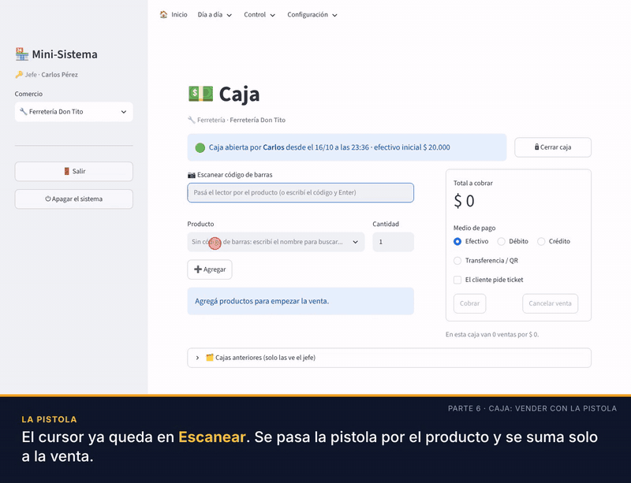
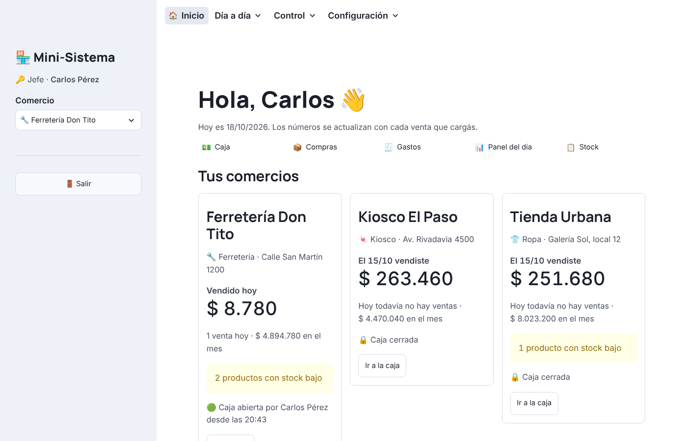
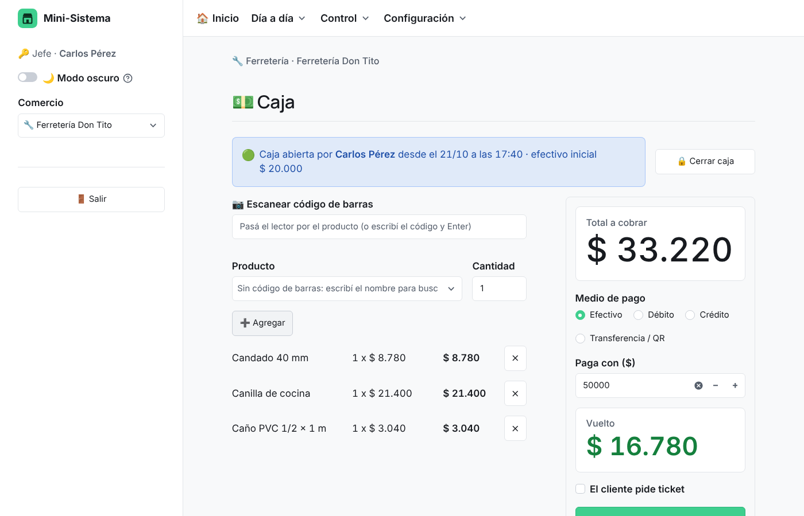
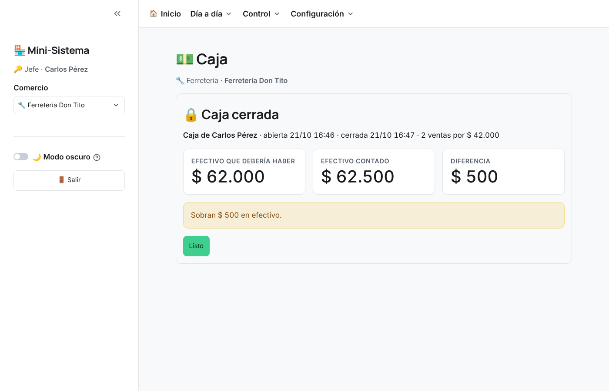
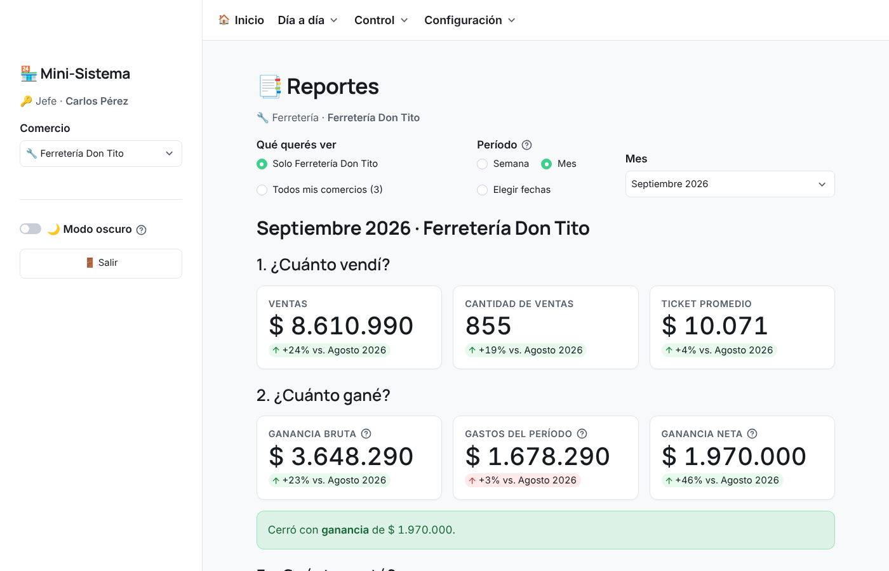
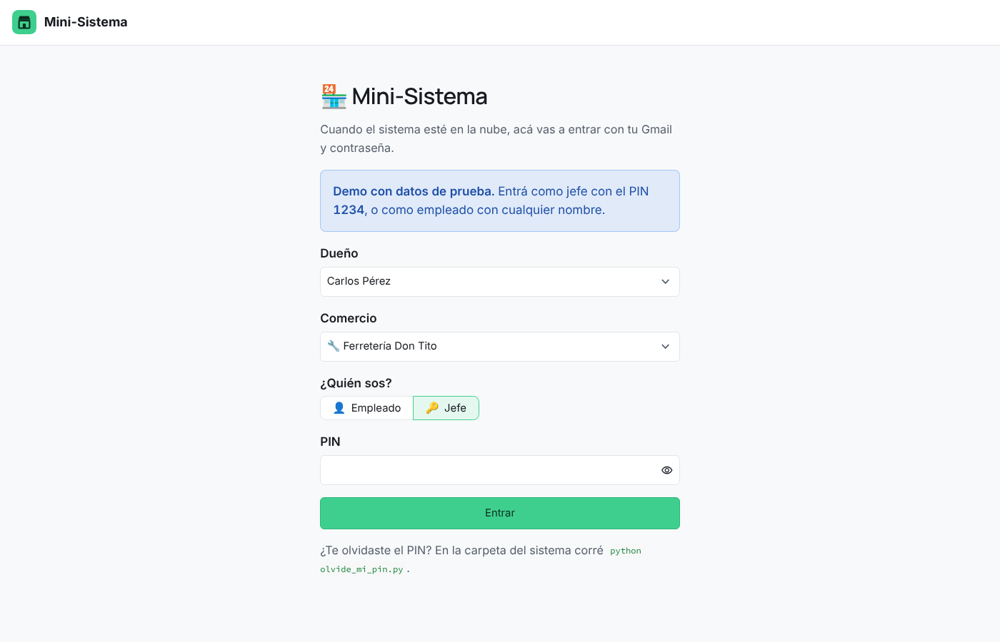

# Mini-Sistema

Un mini ERP para comercios urbanos (kiosco, ferretería, tienda de ropa, panadería...): caja con apertura y cierre, stock, compras, gastos y reportes que le responden al dueño **cuánto vendió, cuánto ganó, cuánto gastó, qué se vende más y qué le falta comprar**. Un dueño puede tener varios comercios y ve solo los suyos.

Proyecto de portfolio hecho por Nahuel, estudiante de Ciencia de Datos (Teclab).

▶️ **Probá la demo online:** https://mini-sistema-demo.streamlit.app (entrá como jefe con el PIN `1234`; los datos son inventados).





## Qué hace

- **Caja:** se abre con el efectivo inicial, se cobra producto por producto (descuenta el stock solo) y al cerrar hace el **arqueo**: cuánto efectivo debería haber, cuánto se contó y si sobra o falta. Una caja cerrada no se puede modificar.
- **Lector de código de barras:** en la Caja cada pasada suma el producto a la venta; en Compras pide la cantidad que llegó. Los códigos se cargan en el Excel de productos (o con el lector en Stock), y si aparece uno desconocido el jefe lo da de alta en el momento.
- **Jefe y empleado:** el jefe entra con su PIN y ve todo; el empleado ve la Caja y solo lo que el jefe le habilite.
- **Reportes** por semana, mes o fechas, en pantalla y en Excel con gráficos. El del mes pasado se guarda solo; el semanal se activa en temporada alta.
- **Panel del día** que se actualiza solo, **stock** con avisos de reposición, **compras**, **gastos**, **ticket en PDF** e **importar/exportar Excel**.

| Caja | Cierre de caja |
|---|---|
|  |  |
| **Reportes** | **Ingreso como jefe o empleado** |
|  |  |

**Hecho con:** Python, pandas, SQLAlchemy, SQLite y Streamlit. Los reportes en Excel se arman con openpyxl y el ticket con fpdf2. La base está escrita con SQLAlchemy para pasarla a PostgreSQL en la nube (Supabase) cambiando una sola línea.

📘 **¿Querés entender cómo funciona todo?** Leé la [guía del sistema](informe/guia/guia-del-sistema.md).

## Cómo abrirlo

Si es la primera vez y no hay base de datos, el sistema crea sola una con datos de prueba (2 dueños, 4 comercios y unos 6 meses de ventas).

La primera vez, abrí una terminal en esta carpeta e instalá las librerías:

```
pip install -r requirements.txt
```

Después, para abrir el sistema, hacé **doble clic en `iniciar.bat`**, o corré:

```
streamlit run app.py
```

Con `iniciar.bat` se abre solo en el navegador. Si lo corrés desde la terminal, entrá vos a `http://localhost:8501`. Para cerrarlo, tocá **⏻ Apagar el sistema** abajo en el menú de la izquierda (se cierra también la ventana negra).

## Las pantallas (paso 2)

Al abrir el sistema elegís el **dueño** y el **comercio**, y entrás como **jefe** (con tu PIN) o como **empleado**. Arriba está el menú; a la izquierda, el jefe cambia de comercio.

| Pantalla | Para qué sirve |
|---|---|
| 🏠 Inicio | El "launcher": todos tus comercios con lo vendido hoy y en el mes, avisos de stock bajo y un botón para abrir la caja de cada uno. |
| 💵 Caja | Primero se **abre la caja** con el efectivo inicial. Después cargás cada venta en el momento: pasás el **lector de código de barras** por cada producto (cada pasada suma 1) o, si no tiene código, lo buscás en la lista; elegís el medio de pago y cobrás (descuenta el stock solo). Si el lector lee un código que no está cargado, el jefe puede crear el producto ahí mismo. Al final del turno se **cierra la caja**: contás el efectivo y el sistema muestra cuánto debería haber y si sobra o falta. Una caja cerrada no se puede modificar. |
| 🧾 Ticket | En los comercios que usan ticket, al cobrar podés tildar "El cliente pide ticket" y se descarga un PDF de 80 mm listo para imprimir. Es un comprobante interno, no una factura de ARCA. |
| 📦 Compras | Cargar lo que le comprás a un proveedor. Con el lector: pasás el producto, escribís la cantidad que llegó y Enter. Suma al stock y actualiza el precio de costo. |
| 🧾 Gastos | Alquiler, luz, sueldos, etc. Sirve para calcular la ganancia real del mes. |
| 📊 Panel del día | Cómo viene el día: vendido, cantidad de ventas, ganancia, ventas por hora, medios de pago y lo más vendido. Se actualiza solo cada 10 segundos y compara con el mismo día de la semana pasada. |
| 📋 Stock | Todos los productos con su estado (✅ OK / ⚠️ Reponer). Podés cambiar precios, cantidades y códigos de barras en la tabla y tocar **Guardar cambios**, o agregar productos nuevos. También podés cargar con el lector los códigos de barras que falten. |
| 📑 Reportes | Por semana, por mes o por las fechas que elijas: cuánto vendí, cuánto gané, cuánto gasté, qué se vende más y qué me falta comprar. Para un comercio o todos juntos, con el botón para **descargar el Excel**. |
| 🏬 Mis comercios | Crear un comercio nuevo (sin tocar código), activar o desactivar los tickets de cada uno, prender o apagar el **resumen semanal** (para la temporada), elegir **qué ve el empleado** y cambiar tu PIN de jefe. |
| 📥 Importar / exportar Excel | Bajar la plantilla o tus productos a Excel, editarlos y volver a subirlos. Si el código ya existe actualiza el producto; si no, lo crea. La columna `codigo_barras` (opcional) es la forma más rápida de cargar todos los códigos de barras de una vez. |

## Jefe y empleado

| | Jefe | Empleado |
|---|---|---|
| Cómo entra | Con su PIN (la primera vez lo crea, de 4 a 6 números) | Con su nombre |
| Qué ve | Todo | La Caja y lo que el jefe le habilite en **Mis comercios**: Panel del día (sin la ganancia), Stock (solo mirar, sin costos), Compras o Gastos |
| Comercio | Cambia de comercio en el menú de la izquierda | Queda fijo en el comercio con el que entró |
| Cajas anteriores | Ve el historial con el arqueo de cada caja | No lo ve |

Si escribís mal el PIN 3 veces, hay que esperar 30 segundos. Si te olvidaste el PIN, en la carpeta del sistema corré `python olvide_mi_pin.py "Tu nombre"` y al entrar te pide uno nuevo. Si recargás la página, el sistema vuelve a pedir que ingreses.

Por ahora el dueño se elige de una lista. Con la nube (paso 5) se entra con Gmail y contraseña.

**Modo demo.** Con la variable `MODO_DEMO = "1"` (en Streamlit Community Cloud va en los *Secrets* de la app), el PIN del jefe viene puesto en `1234`, la pantalla de ingreso lo muestra y se ocultan el botón para apagar y el cambio de PIN. En Streamlit Community Cloud el modo demo se prende solo, aunque falte ese Secret, y el botón para apagar nunca aparece en internet.

**Reseñas.** Si en los *Secrets* de la app se pone `FORMULARIO_RESENAS = "https://forms.gle/..."` (el link de un formulario de Google), aparece en la barra de la izquierda el botón **💬 Dejá tu reseña**. Las respuestas llegan a la planilla del formulario y no tocan la base de datos.

## Próximo: la nube (paso 5)

La base pasa de SQLite a **Supabase** (PostgreSQL en internet) y la página se sube a un servidor (**Render** o **Railway**). Como el sistema usa SQLAlchemy, para cambiar de base alcanza con cambiar la dirección en `config.py`. Así varios comercios usan la misma base y el dueño ve todo en vivo, también desde el celular.

## Reportes (paso 3)

En **Control → Reportes** elegís el **período** (una semana, un mes o las fechas que quieras) y si querés ver un comercio o todos juntos. La pantalla y el Excel responden 5 preguntas:

| Pregunta | Qué muestra |
|---|---|
| 1. ¿Cuánto vendí? | Ventas, cantidad de ventas, ticket promedio y unidades, comparado con el período anterior. |
| 2. ¿Cuánto gané? | Ganancia bruta (ventas − costo de la mercadería), gastos y ganancia neta. Dice si el período dio ganancia o pérdida. |
| 3. ¿Cuánto gasté? | Gastos por categoría y compras de mercadería a proveedores. |
| 4. ¿Qué se vende más? | El ranking de productos, del más al menos vendido (incluye los que no se vendieron nada). |
| 5. ¿Qué me falta comprar? | Lo que está en el stock mínimo o no llega a una semana, con la cantidad sugerida (para unas 2 semanas, según lo vendido en las últimas 4) y el costo, ordenado por proveedor. |

**Gastos en una semana.** El alquiler, la luz o los sueldos se cargan el día que se pagan, pero son de todo el mes. Por eso se reparten por día: a una semana le tocan 7 días de gastos. En un mes completo, da el gasto entero. Si el período todavía no terminó, se compara con los mismos días del período anterior.

**El Excel** tiene las hojas Resumen (las 5 respuestas con gráficos), Por comercio (si elegís todos), Productos, Qué comprar, Ventas, Compras y Gastos.

**Se guardan solos.** Al abrir el sistema se guarda el Excel del **mes pasado** de cada comercio en `reportes/<comercio>/mensuales` (y uno con todos juntos si el dueño tiene varios). El **resumen semanal** es opcional: se prende y se apaga con un botón por comercio (en Mis comercios o en Reportes) y, si está prendido, también se guarda el Excel de la semana pasada en `reportes/<comercio>/semanales`.

**Aviso de temporada.** De diciembre a febrero, el Inicio muestra "¡Arranca la temporada! Activá el resumen semanal" con el botón para prenderlo. En marzo avisa que terminó la temporada y ofrece apagarlo. Los meses se cambian en `comun.py` (`MESES_TEMPORADA`). Desde la terminal: `python reportes.py` (mes pasado, y semana pasada si está prendido el semanal), `python reportes.py 2026-09` (un mes) o `python reportes.py 2026-10-06` (la semana de ese día).


## Qué hay en la carpeta

| Archivo | Para qué sirve |
|---|---|
| `app.py` | Arranca la aplicación y arma el menú. |
| `paginas/` | Una pantalla por archivo (caja.py, stock.py, etc.). |
| `operaciones.py` | Todas las lecturas y escrituras en la base. Las pantallas no escriben SQL: llaman a estas funciones. |
| `ticket.py` | Arma el ticket en PDF. |
| `ingreso.py` | La pantalla para entrar como jefe o empleado. |
| `olvide_mi_pin.py` | Borra el PIN del jefe si se lo olvidó. |
| `reportes.py` | Arma el Excel (semanal, mensual o de otras fechas) con gráficos y guarda solos el de la semana y el mes pasados. |
| `reportes/` | Los Excel semanales y mensuales guardados solos (se crea al abrir el sistema). |
| `informe/` | Todo lo informativo, separado por tipo: |
| `informe/ejemplos/` | Dos Excel de ejemplo hechos con los datos de prueba (los 3 comercios de Carlos): uno de septiembre y uno de la semana del 5 al 11 de octubre. |
| `informe/capturas/` | Capturas de pantalla del sistema. |
| `informe/videos/` | Video tutorial completo, versión corta para LinkedIn y el GIF de la caja (los MP4 no se suben a GitHub). |
| `informe/guia/` | La guía para entender todo el sistema (en .md y en Word). |
| `comun.py` | Cosas que comparten las pantallas (formato de pesos, medios de pago...). |
| `config.py` | Dice dónde está la base. En el paso 5 (nube) solo se cambia esta línea. |
| `base_datos.py` | Define las tablas y cómo se relacionan. |
| `generar_datos_prueba.py` | Crea los comercios de prueba y simula 6 meses y medio de ventas, compras y gastos. |
| `ver_resumen.py` | Consultas SQL de ejemplo: ganancia por comercio, por mes y productos más y menos vendidos. |
| `esquema.sql` | El SQL de las tablas, generado solo. Es para leerlo. |
| `mini_sistema.db` | La base de datos SQLite. |
| `iniciar.bat` | Doble clic para abrir el sistema en Windows. |
| `.streamlit/config.toml` | Colores y opciones de Streamlit. |

## Cómo están organizadas las tablas

```
duenos
  └── comercios              un dueño tiene 1 o más comercios
        ├── productos        con precio de costo, precio de venta, stock y código de barras
        ├── proveedores
        ├── compras ── compras_detalle   lo que se compra a proveedores
        ├── cajas            cada apertura y cierre de caja, con el arqueo
        ├── ventas  ── ventas_detalle    lo que se vende a clientes (cada venta queda en su caja)
        │     └── tickets    solo si el cliente pidió ticket
        └── gastos           alquiler, luz, sueldos, impuestos
```

¿Por qué ventas y ventas_detalle por separado? Porque una venta (un cliente que paga) puede tener varios productos. `ventas` guarda el total, la hora y el medio de pago; `ventas_detalle` guarda cada producto de esa venta. Con compras pasa lo mismo.

`ventas_detalle` guarda el precio **y el costo** del día de la venta. Así la ganancia queda bien calculada aunque después cambien los precios por la inflación.

## Los datos de prueba

| Dueño | Comercio | Rubro | Usa ticket |
|---|---|---|---|
| Carlos Pérez | Kiosco El Paso | kiosco | No |
| Carlos Pérez | Ferretería Don Tito | ferretería | Sí |
| Carlos Pérez | Tienda Urbana | ropa | Sí |
| Laura Gómez | Kiosco La Esquina | kiosco | No |

- Período: del 1/4/2026 al 15/10/2026. Son unas 34.000 ventas.
- Las ventas siguen el horario de cada comercio. Hay más los sábados, y la ferretería y la tienda cierran los domingos.
- La tienda de ropa vende más en invierno y antes del Día de la Madre, y mucho menos en agosto. La ferretería vende más en primavera.
- Los precios suben 2% por mes (inflación).
- Cuando el stock baja, el comercio le compra al proveedor en sus días de reposición.
- Los gastos fijos se cargan el día 5 de cada mes.
- Los productos tienen códigos de barras inventados (empiezan con 779, como los de Argentina), salvo los tornillos sueltos de la ferretería, que se eligen de la lista.
- **Octubre sale con poca ganancia o en negativo** porque solo tiene 15 días de ventas pero ya tiene los gastos del mes completo.

`python generar_datos_prueba.py` **borra y vuelve a crear** la base, incluidas las ventas que hayas cargado a mano en la Caja. Usalo para volver a empezar de cero.
