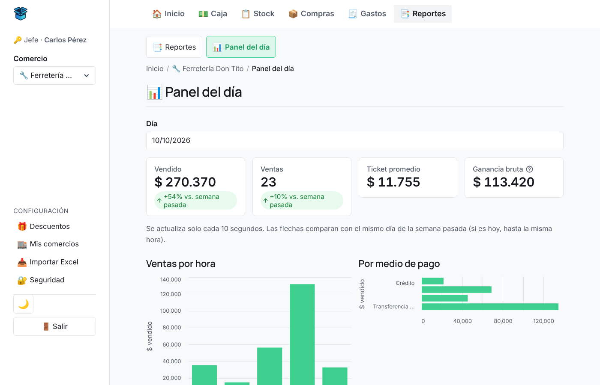
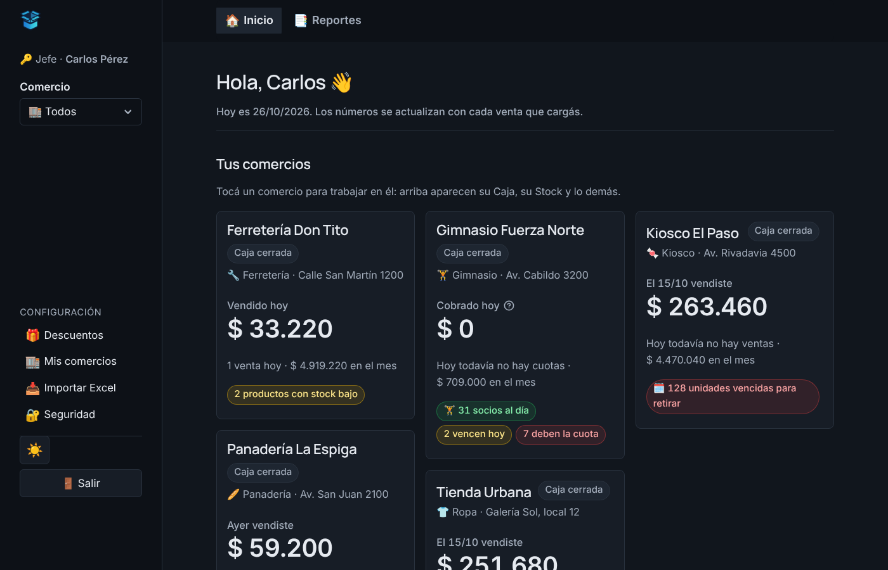
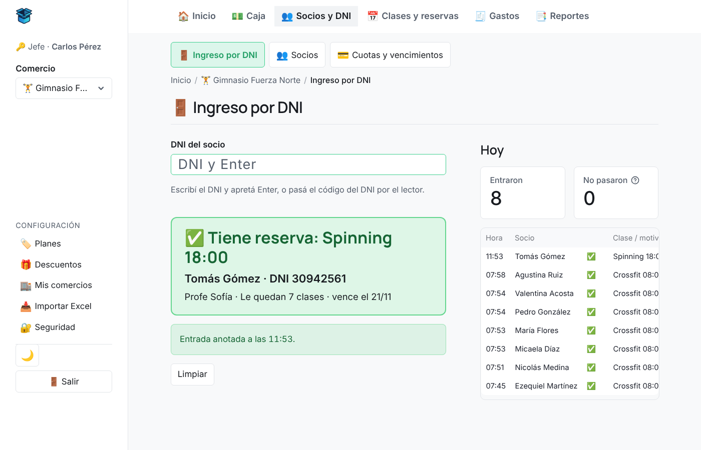
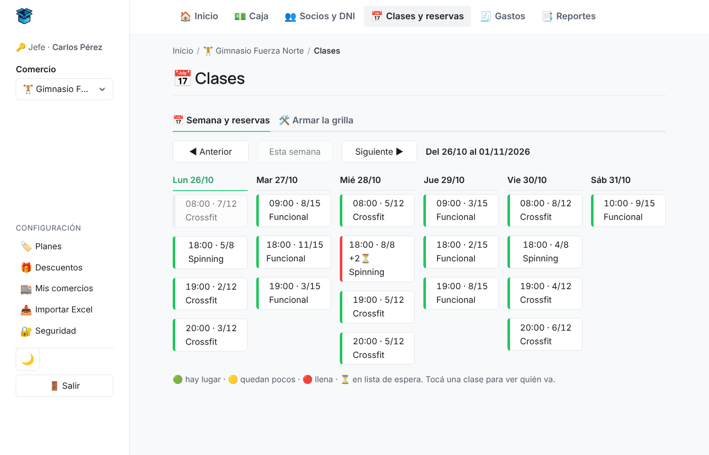

# Mini-Sistema

Un mini ERP para comercios urbanos (kiosco, ferretería, tienda de ropa, panadería, gimnasio...): caja con apertura y cierre, stock, compras, gastos y reportes que le responden al dueño **cuánto vendió, cuánto ganó, cuánto gastó, qué se vende más y qué le falta comprar**. Un dueño puede tener varios comercios y ve solo los suyos. Los gimnasios suman socios, planes, cuotas, ingreso por DNI y clases con reservas.

Proyecto de portfolio hecho por Nahuel, estudiante de Ciencia de Datos (Teclab).

▶️ **Probá la demo online:** https://mini-sistema-demo.streamlit.app (entrá como jefe con el PIN `1234`; los datos son inventados). Para ver el gimnasio, elegí el comercio **Gimnasio Fuerza Norte** y probá el DNI `30000000` en el Ingreso. La página para que el socio reserve desde el celular viene apagada: para probarla, prendela en **Planes y actividades → 📱 Reservas desde el celular** y abrí https://mini-sistema-demo.streamlit.app/?reservar=fuerzanorte (entrá con el mismo DNI). Para ver las promos, elegí **Panadería La Espiga**: trae una 2da unidad al 50 % en Facturas, 10 % en efectivo y un botón de Jubilados en la Caja.


## Qué hace

- **Caja:** se abre con el efectivo inicial, se cobra producto por producto (descuenta el stock solo) y al cerrar hace el **arqueo**: cuánto efectivo debería haber, cuánto se contó y si sobra o falta. Si cambia quien atiende (mañana / tarde), se hace un **relevo de turno** sin cerrar la caja: el que se va cuenta el efectivo y queda anotado en qué turno faltó o sobró plata. Si pagan en efectivo, calcula el **vuelto**. Una caja cerrada no se puede modificar: si hubo un error, el jefe le hace un **ajuste** (anular una venta o corregir el conteo) que queda anotado con fecha, quién y por qué.
- **Descuentos y promos:** el jefe arma 2x1, 3x2, 2da unidad al %, un % en un producto o una categoría, un % por medio de pago (por ejemplo, 10 % en efectivo) y, en los gimnasios, un % en la cuota de un plan. Cada promo puede ser **automática** (la Caja la aplica sola) o **con botón** (el empleado la toca si corresponde: jubilados, cliente frecuente...). La Caja muestra el subtotal, cada promo con lo que descuenta y el total; el ticket dice cuánto ahorró el cliente y los reportes, cuánto se descontó.
- **Lector de código de barras:** en la Caja cada pasada suma el producto a la venta; en Compras pide la cantidad que llegó. Los códigos se cargan en el Excel de productos (o con el lector en Stock), y si aparece uno desconocido el jefe lo da de alta en el momento.
- **Vencimientos:** para lo que dura pocos días (postres, lácteos, pan). Cada producto puede tener "Dura X días" y cada tanda que entra queda con su fecha. El sistema avisa qué vence hoy y qué hay que retirar, y lo que se tira queda anotado como pérdida en los reportes.
- **Avisos al celular del jefe por Telegram:** cuando se abre o se cierra la caja (con el efectivo esperado, el contado y si faltó o sobró), en cada relevo de turno y cuando un producto llega al stock mínimo. Salen por detrás: la Caja no se demora y, si no hay internet, se cobra igual.
- **Jefe y empleado:** el jefe entra con su PIN y ve todo; el empleado ve la Caja y solo lo que el jefe le habilite.
- **Reportes** por semana, mes o fechas, en pantalla y en Excel con gráficos. El del mes pasado se guarda solo; el semanal se activa en temporada alta.
- **Panel del día** que se actualiza solo, **stock** con avisos de reposición, **compras**, **gastos**, **ticket en PDF** e **importar/exportar Excel**.
- **Gimnasio:** si el comercio es del rubro Gimnasio aparecen **Ingreso por DNI** (el socio sale en verde, amarillo o rojo y, si debe, se le cobra ahí mismo), **Socios**, **Cuotas y vencimientos** (con el recordatorio por WhatsApp), **Clases** (la grilla de la semana con cupo, reservas, **lista de espera** automática y el botón **📅 Agregar al calendario**), **Planes y actividades** (por mes o varios meses, libres o con clases por mes, para todas las actividades o solo algunas: crossfit, funcional, pesas libres...) y la **página de reservas del socio**: con un link o un QR, el socio entra con su DNI desde el celular, ve los lugares que quedan, reserva o cancela y lo agrega a su Google Calendar. La cuota entra a la **caja abierta** como una venta, así el arqueo, el relevo de turno y el cierre la incluyen. Ver [El gimnasio](#el-gimnasio).
- **Modo claro u oscuro:** se cambia con el botón del sol o la luna (☀️ / 🌙) abajo en la barra de la izquierda, al instante. Lo que elige el jefe queda guardado y sus empleados arrancan con eso (también pueden cambiarlo mientras están adentro).

| Caja | Cierre de caja |
|---|---|
|  |  |
| **Reportes** | **Ingreso como jefe o empleado** |
|  |  |
| **Panel del día** | **Modo oscuro** |
|  |  |
| **Gimnasio: ingreso por DNI** | **Gimnasio: clases de la semana** |
|  |  |

**Hecho con:** Python, pandas, SQLAlchemy, SQLite, Streamlit y la API de bots de Telegram. Los reportes en Excel se arman con openpyxl, el ticket con fpdf2 y el QR del calendario con segno. La base está escrita con SQLAlchemy para pasarla a PostgreSQL en la nube (Supabase) cambiando una sola línea.

📘 **¿Querés entender cómo funciona todo?** Leé la [guía del sistema](informe/guia/guia-del-sistema.md).

## Cómo abrirlo

Si es la primera vez y no hay base de datos, el sistema crea sola una con datos de prueba (2 dueños, 4 comercios y unos 6 meses de ventas). Para probar el gimnasio en tu PC, creá un comercio del rubro **Gimnasio** en Mis comercios y, en **Planes y actividades**, tocá **Cargar el ejemplo**.

La primera vez, abrí una terminal en esta carpeta e instalá las librerías:

```
pip install -r requirements.txt
```

Después, para abrir el sistema, hacé **doble clic en `iniciar.bat`**, o corré:

```
streamlit run app.py
```

Con `iniciar.bat` se abre solo en el navegador. Si lo corrés desde la terminal, entrá vos a `http://localhost:8501`. Para cerrarlo, tocá **⏻ Apagar el sistema** abajo en el menú de la izquierda (se cierra también la ventana negra).

## Las pantallas (paso 2)

Al abrir el sistema elegís el **dueño** y el **comercio**, y entrás como **jefe** (con tu PIN) o como **empleado**, en una tarjeta centrada con el logo arriba.

**La barra de arriba** es una sola fila de pestañas, sin menús que se despliegan, y cambia según el comercio elegido (`menu.py`):

- Con **Todos** elegido: Inicio y Reportes (para ver todos los comercios juntos).
- En un comercio que vende productos: Inicio, Caja, Stock, Compras, Gastos y Reportes.
- En un gimnasio: Inicio, Caja, Socios y DNI, Clases y reservas, Gastos y Reportes.

Las pestañas que juntan varias pantallas muestran una segunda fila abajo (por ejemplo, Reportes y Panel del día, o Ingreso por DNI, Socios y Cuotas). **A la izquierda**, el jefe cambia de comercio (o toca la tarjeta del comercio en el Inicio) y abajo tiene la **Configuración**: Descuentos, Mis comercios, Importar Excel y Seguridad (y Planes, en los gimnasios). El empleado ve solo las pestañas que el jefe le habilitó.

| Pantalla | Para qué sirve |
|---|---|
| 🏠 Inicio | El "launcher". Con **Todos**: una tarjeta por comercio con lo vendido hoy y en el mes, si la caja está abierta y los avisos (stock bajo, vencimientos, cuotas). Toda la tarjeta es un botón: al tocarla entrás a ese comercio y la barra de arriba muestra sus pantallas. Con un comercio elegido: su tablero con 4 números clave (vendido hoy, ventas de hoy, vendido en el mes y ganancia; en un gimnasio, cobrado hoy y en el mes, socios al día y los que deben) y el botón **← Todos mis comercios**. |
| 💵 Caja | Primero se **abre la caja** con el efectivo inicial. Después cargás cada venta en el momento: pasás el **lector de código de barras** por cada producto (cada pasada suma 1) o, si no tiene código, lo buscás en la lista. Para cambiar cuántas unidades lleva, tocás **−** o **+** al lado del número (el total y el vuelto se recalculan solos; el + no pasa el stock y el − no baja de 1, para sacarlo está la X). Elegís el medio de pago y cobrás (descuenta el stock solo). Las **promos** se aplican solas: arriba del total aparecen el subtotal y cada promo con lo que descuenta, y en cada producto el precio sin promo tachado. Las promos "con botón" (por ejemplo, jubilados) aparecen en **🏷️ Promos para elegir** para tocarlas si corresponde. Si pagan en efectivo, escribís con cuánto pagan y el sistema muestra el **vuelto** (si no alcanza, avisa cuánto falta). Si el lector lee un código que no está cargado, el jefe puede crear el producto ahí mismo. Si cambia quien atiende, el que se va toca **🔄 Relevo de turno**: cuenta el efectivo, escribe quién recibe y queda anotado si en su turno faltó o sobró plata, sin cerrar la caja (el que entra arranca con lo contado). Al final del día se **cierra la caja**: contás el efectivo y el sistema muestra cuánto debería haber y si sobra o falta. Una caja cerrada no se puede modificar, pero el jefe (o el empleado al que le dé el permiso "Ajustar cajas cerradas"), en **Cajas anteriores**, le puede hacer un **ajuste**: anular una venta (deja de contar y la mercadería vuelve al stock) o anotar un nuevo conteo del efectivo. Cada ajuste queda anotado con fecha, quién y motivo, y el historial muestra la diferencia antes y después. En **Turnos de una caja** se ve la línea de tiempo del día: quién abrió, cada relevo y el cierre, con lo que dio cada turno. |
| 🧾 Ticket | En los comercios que usan ticket, al cobrar podés tildar "El cliente pide ticket" y se descarga un PDF de 80 mm listo para imprimir. Es un comprobante interno, no una factura de ARCA. |
| 📦 Compras | Cargar lo que le comprás a un proveedor. Con el lector: pasás el producto, escribís la cantidad que llegó y Enter. Suma al stock y actualiza el precio de costo. El empleado también puede cargar lo que llega (viene habilitado; el jefe se lo saca en Mis comercios), pero solo pone cantidades, sin ver costos. Cada compra guarda quién la cargó. |
| 🗓️ Vencimientos | Aparece en las panaderías y en los comercios que tengan algún producto con **Dura (días)**. Muestra lo que hay por tanda (cuándo entró y cuándo vence), lo vencido para retirar y lo que vence hoy o mañana. Lo que llega del proveedor se anota solo desde Compras; lo que se hornea o prepara se carga acá ("Cargar lo que salió hoy"). Con **Ya lo retiré** lo vencido sale del stock y queda como pérdida (a costo). Se cuenta que siempre se vende primero lo más viejo. Si no fue así, **Sacar de una tanda** permite elegir de qué tanda salió (vendido, tirado o regalado). El Inicio y la Caja avisan cuando hay algo vencido o que vence hoy. |
| 🧾 Gastos | Alquiler, luz, sueldos, etc. Sirve para calcular la ganancia real del mes. |
| 📊 Panel del día | Cómo viene el día: vendido, cantidad de ventas, ganancia, ventas por hora, medios de pago y lo más vendido. Se actualiza solo cada 10 segundos y compara con el mismo día de la semana pasada. |
| 📋 Stock | Todos los productos con su estado (✅ OK / ⚠️ Reponer). Podés cambiar precios, cantidades, códigos de barras y cuántos días dura cada producto (**Dura (días)**, vacío = no vence) en la tabla y tocar **Guardar cambios**, o agregar productos nuevos. También podés cargar con el lector los códigos de barras que falten. |
| 📑 Reportes | Por semana, por mes o por las fechas que elijas: cuánto vendí, cuánto gané, cuánto gasté, qué se vende más y qué me falta comprar. Si se tiró mercadería vencida, aparece como pérdida y se resta de la ganancia neta. Para un comercio o todos juntos, con el botón para **descargar el Excel**. |
| 🎁 Descuentos y promos | Solo el jefe. Armar promos: **2x1, 3x2 o 2da unidad al %**, **% en un producto, una categoría o todo**, **% por medio de pago** y, en los gimnasios, **% en un plan**. Cada una puede valer solo algunos días de la semana o entre dos fechas, y ser **automática** o **con botón en la Caja**. Se prenden y apagan con un interruptor, se editan y se filtran por tipo. En **⚙️ Cómo se combinan** el jefe elige qué pasa si a un producto le tocan dos promos: va la que más ahorra (viene así) o se suman. La de medio de pago va siempre encima. |
| 🏬 Mis comercios | Tres pestañas. **Mis comercios:** una tarjeta por comercio con interruptores para **Da ticket**, **Resumen semanal** (para la temporada) y **Mandar avisos**, y el botón **➕ Nuevo comercio** (sin tocar código). **Mis empleados:** elegir **qué ve el empleado** en cada comercio (se guarda solo al tocar) y cargar los **horarios y turnos** del local (la Caja avisa cuándo termina un turno y si está abierta fuera de horario). **Avisos al celular:** conectar Telegram y elegir los avisos. |
| 🔐 Seguridad | Cambiar tu PIN de jefe. |
| 🚪 Ingreso por DNI | Solo en gimnasios. Se escribe el DNI (o se pasa el DNI por el lector) y el socio sale en **verde** (pasa y queda anotada la entrada; si tenía reserva, pasa a "vino"), **amarillo** (al día pero sin reserva: se lo anota en una clase de hoy o se lo deja pasar igual) o **rojo** (debe la cuota o no le quedan clases: se le cobra ahí mismo). Si el DNI no existe, se lo da de alta en el momento. A la derecha, quién entró hoy. |
| 👥 Socios | Solo en gimnasios. Buscador por nombre o DNI, filtros (al día, vencen pronto, deben, sin clases, de baja) y la ficha de cada socio: cobrarle la cuota, sus reservas (anotarlo, cancelar, agregar al calendario), sus cuotas y entradas, y sus datos. Dar de baja lo hace solo el jefe. |
| 💳 Cuotas y vencimientos | Solo en gimnasios. Cobrar una cuota, quién vence en los próximos días y quién ya debe, con un botón que abre **WhatsApp con el recordatorio escrito**, y las últimas cuotas con quién cobró y en qué turno. |
| 📅 Clases | Solo en gimnasios. La grilla de la semana con el cupo de cada clase (🟢 hay lugar, 🟡 quedan pocos, 🔴 llena). Al tocar una clase: anotar socios (si está llena, van a la **lista de espera**), marcar quién vino o faltó, cancelar (con la regla de horas a la vista) y **📅 Agregar al calendario** (Google Calendar, archivo .ics con recordatorio, QR o WhatsApp). El jefe arma la grilla en "Armar la grilla". |
| 🏷️ Planes y actividades | Solo el jefe de un gimnasio. Las actividades (crossfit, funcional, pesas libres... y las que agregue), los planes (precio; 1, 2, 3, 6 o 12 meses o una cantidad de días; libres o con clases por mes; para todas las actividades o algunas) las reglas (horas para cancelar, qué pasa con las clases que sobran, si la cuota vence a fin de mes) y **📱 Reservas desde el celular** (prenderlas, el link para los socios, el QR para imprimir y cambiar el link). Si el gimnasio está vacío, **Cargar el ejemplo** lo deja armado. |
| 📥 Importar / exportar Excel | Bajar la plantilla o tus productos a Excel, editarlos y volver a subirlos. Si el código ya existe actualiza el producto; si no, lo crea. La columna `codigo_barras` (opcional) es la forma más rápida de cargar todos los códigos de barras de una vez, y `dias_duracion` (opcional) dice cuántos días dura cada producto. |

## Jefe y empleado

| | Jefe | Empleado |
|---|---|---|
| Cómo entra | Con su PIN (la primera vez lo crea, de 4 a 6 números) | Con su nombre |
| Qué ve | Todo | La Caja y lo que el jefe le habilite en **Mis comercios**: Panel del día (sin la ganancia), Stock (solo mirar, sin costos), Compras (cargar lo que llega, sin costos), Vencimientos (cargar tandas y retirar lo vencido), Gastos o Ajustar cajas cerradas (ve las cajas anteriores y las corrige). En los comercios nuevos vienen habilitados Panel del día, Stock, Compras y Vencimientos. |
| Comercio | Cambia de comercio en la barra de la izquierda o tocando su tarjeta en el Inicio | Queda fijo en el comercio con el que entró |
| Cajas anteriores | Ve el historial con el arqueo de cada caja, los turnos de cada día y puede ajustarlas | Solo si el jefe le da el permiso "Ajustar cajas cerradas" |
| Relevo de turno | Sí | Sí (ve solo lo de su turno) |
| Horarios y turnos del local | Los carga en Mis comercios | No |
| Descuentos y promos | Los arma en Descuentos y promos | Se le aplican solos en la Caja; toca los botones de las promos "con botón" si corresponde |
| Gimnasio | Todo, más Planes y actividades | Ingreso por DNI y Caja siempre; Socios, Cuotas y Clases si el jefe se los habilita (en los gimnasios nuevos vienen habilitados). Cobra el precio del plan con sus promos (el jefe puede hacer otro descuento a mano o cambiar el vencimiento) |

Si escribís mal el PIN 3 veces, hay que esperar 30 segundos. Si te olvidaste el PIN, en la carpeta del sistema corré `python olvide_mi_pin.py "Tu nombre"` y al entrar te pide uno nuevo. Si recargás la página, el sistema vuelve a pedir que ingreses.

Por ahora el dueño se elige de una lista. Con la nube (paso 5) se entra con Gmail y contraseña.

**Modo demo.** Con la variable `MODO_DEMO = "1"` (en Streamlit Community Cloud va en los *Secrets* de la app), el PIN del jefe viene puesto en `1234`, la pantalla de ingreso lo muestra y se ocultan el botón para apagar y el cambio de PIN (en Seguridad). En Streamlit Community Cloud el modo demo se prende solo, aunque falte ese Secret, y el botón para apagar nunca aparece en internet.

**Reseñas.** Si en los *Secrets* de la app se pone `FORMULARIO_RESENAS = "https://forms.gle/..."` (el link de un formulario de Google), aparece en la barra de la izquierda el botón **💬 Dejá tu reseña**. Las respuestas llegan a la planilla del formulario y no tocan la base de datos.

## Avisos al celular (Telegram)

Al jefe le llega un mensaje en Telegram cuando:

| Aviso | Qué dice |
|---|---|
| 🔓 Apertura de caja | Quién abrió y con cuánto efectivo |
| 🔔 Cierre de caja | Quién cerró, ventas (y cuántas fueron cuotas, en un gimnasio), efectivo esperado, contado y si faltó o sobró |
| 🔄 Relevo de turno | Quién entregó y quién recibe, y si en ese turno faltó o sobró |
| 📦 Falta de stock | Qué producto llegó al mínimo (un solo aviso, no uno por venta) |
| 🏋️ Lista de espera | Solo gimnasios: quién entró solo a una clase porque otro canceló, con su teléfono para avisarle |

**El jefe se conecta con 2 toques:** en **Mis comercios → 📲 Avisos al celular** toca **📲 Conectar con Telegram**, abre el link y toca **Iniciar** en Telegram. El sistema se da cuenta solo y el bot le escribe "Listo, quedaste conectado". No hace falta su número: se conecta con su cuenta de Telegram. Después elige qué avisos quiere en cada comercio, puede mandar un mensaje de prueba, apagarlos o desconectarse.

**Quien instala el sistema crea el bot una sola vez:** le escribe `/newbot` a **@BotFather** en Telegram y guarda el **token** que le da en el `.env` de la carpeta (o lo pega en Mis comercios, que lo guarda ahí; no se sube a GitHub). En la nube va en los *Secrets* del servidor (`TELEGRAM_BOT_TOKEN`). Un solo bot sirve para todos los clientes.

**Cómo funciona por dentro** (`notificaciones_telegram.py`):

- La tabla `configuracion_telegram` tiene una fila por comercio (`comercio_id` único) con el chat del jefe (`telegram_chat_id`), el código de un solo uso del link (`token_vinculacion`), si está `activo` y qué `eventos` quiere. Cada aviso se busca por `comercio_id`: un comercio nunca le avisa al chat de otro.
- El link es `https://t.me/<bot>?start=<código>`. Al tocar **Iniciar**, Telegram le manda al bot `/start <código>`; el sistema lo lee con `getUpdates`, guarda el chat en los comercios con ese código y borra el código. En la nube se puede cambiar por un *webhook* usando la misma función (`procesar_mensaje`).
- `enviar_alerta_telegram(comercio_id, mensaje, parse_mode)` devuelve `True` si el mensaje llegó. Los avisos del sistema se mandan en un hilo aparte (segundo plano) con `requests` y un límite de 10 segundos; si falla, no rompe nada.
- Los mensajes van en formato HTML de Telegram (negritas, emojis y renglones cortos para leerlos desde la notificación). Se eligió HTML y no Markdown porque un nombre como `Coca_Cola` rompe el formato Markdown.
- **Demo:** sin el Secret `TELEGRAM_BOT_TOKEN` en Streamlit Cloud, no se manda ningún aviso.

## El gimnasio

Se prende solo en los comercios del rubro **Gimnasio** (un kiosco o una ferretería no ven nada nuevo). Todo se guarda en la misma base, con tablas nuevas, y cada una lleva el `comercio_id`: un gimnasio nunca ve los socios, planes o clases de otro, aunque sean del mismo dueño.

**Planes.** Cada plan tiene precio, duración (1, 2, 3, 6 o 12 meses, o una cantidad de días, como un pase de 15 días), clases (libre o una cantidad por mes: un trimestral de 8 por mes carga 24) y actividades (todas o solo algunas, por ejemplo un plan de Pesas libres). Las actividades las agrega el jefe.

**Cuotas.** Al cobrar, el sistema calcula hasta cuándo vale y cuántas clases le carga, según las reglas del gimnasio: si renueva antes de que venza, lo nuevo arranca cuando termina lo que ya pagó; las clases que no usó vencen o se acumulan; un plan por meses vale los meses del calendario o hasta fin de mes. La cuota se guarda como una **venta de la caja abierta** (sin productos) más una fila en `cuotas_cobradas` con quién cobró, el relevo de turno en el que se cobró y cómo estaba el socio antes. Por eso el arqueo, el relevo, el cierre, el Panel del día, los Reportes y el aviso de Telegram ya la incluyen. Si hubo un error, el jefe la anula en Cajas anteriores y el socio vuelve a como estaba.

**Reservas sin sobrecupo.** `reservar_clase` traba la clase dentro de la transacción antes de contar los lugares (en PostgreSQL es un bloqueo de esa fila; en SQLite, el bloqueo de escritura de la base). Si dos personas reservan el último lugar al mismo tiempo, entra una sola y la otra va a la **lista de espera**. Se probó con 25 reservas a la vez para una clase de 3 lugares, en SQLite y en PostgreSQL: 3 adentro y 22 en espera. Cancelar a tiempo devuelve la clase y el primero de la espera entra solo (si sigue al día y le quedan clases).

**📅 Agregar al calendario.** Cada reserva tiene un botón con el link de **Google Calendar** (con la hora de Argentina), un archivo **.ics** con recordatorio 1 hora antes (para iPhone u otro calendario), un **QR** para que el socio lo escanee con el celular y el mensaje listo para **WhatsApp**. Así el gimnasio no tiene que mandarle avisos al socio: se lo recuerda su propio celular.

**📱 Reservas desde el celular.** Vienen **apagadas**: mientras tanto, el jefe y recepción anotan a los socios a mano (en Clases, en la ficha de Socios o en el Ingreso por DNI), con el mismo cupo. Si el gimnasio las quiere, el jefe las prende en **Planes y actividades → 📱 Reservas desde el celular** y comparte el link del gimnasio (`…/?reservar=código`) por WhatsApp o Instagram, o imprime el **QR** para el mostrador. El socio abre el link, escribe su **DNI** y ve:

- su plan, cuántas clases le quedan y hasta cuándo vale (si debe, le dice que pague en recepción y no lo deja reservar),
- sus reservas, con el botón para agregarlas al calendario y el de cancelar (le avisa antes si ya es tarde y la clase no se devuelve),
- las clases de los próximos 7 días que entran en su plan, con los **lugares que quedan** de cada una. Si está llena, se anota en la **lista de espera**.

Al reservar le aparecen los botones **📅 Agregar a Google Calendar** y el archivo **.ics** (iPhone u otro calendario). Usa las mismas funciones que la recepción (`reservar_clase` con `origen="web"`), así que respeta el mismo cupo y la misma lista de espera; en Clases y en la ficha del socio esas reservas se ven con **📱**. La página no muestra el menú del sistema ni pide PIN, y el socio solo ve lo suyo. Para entrar alcanza con el DNI, para que sea simple. Para que nadie pruebe DNIs al azar, después de 3 DNIs equivocados la página hace esperar 30 segundos y, si en un gimnasio hay 20 DNIs que no existen en 10 minutos, frena 10 minutos. Si el link se compartió de más, el jefe toca **Cambiar el link** y el viejo deja de andar. En la PC el link abre solo en esa computadora; para que los socios lo usen desde su casa, el sistema tiene que estar en internet (como la demo).

**Demo.** En la demo online se crea solo **Gimnasio Fuerza Norte**, con 4 actividades, 6 planes, la grilla de la semana, unos 38 socios (al día, que vencen, que deben y sin clases), reservas de esta semana y la próxima (una clase llena con lista de espera; algunas hechas desde el celular), buffet y gastos fijos. La página de reservas viene apagada, como en cualquier gimnasio; si la prendés, el link es `?reservar=fuerzanorte`. El socio de prueba (DNI `30000000`, plan de 8 clases) arranca sin reservas para que las hagas vos. Las fechas se calculan desde el día en que se arma.

## Próximo: la nube (paso 5)

La base pasa de SQLite a **Supabase** (PostgreSQL en internet) y la página se sube a un servidor (**Render** o **Railway**). Como el sistema usa SQLAlchemy, para cambiar de base alcanza con cambiar la dirección en `config.py`. Así varios comercios usan la misma base y el dueño ve todo en vivo, también desde el celular. En los gimnasios, la página de reservas del socio ya funciona: en la nube la usan desde su casa.

## Reportes (paso 3)

En la pestaña **📑 Reportes** elegís el **período** (una semana, un mes o las fechas que quieras) y si querés ver un comercio o todos juntos. La pantalla y el Excel responden 5 preguntas:

| Pregunta | Qué muestra |
|---|---|
| 1. ¿Cuánto vendí? | Ventas, cantidad de ventas, ticket promedio y unidades, comparado con el período anterior. En un gimnasio, también las cuotas y el total cobrado. Si hubo promos, **cuánto se descontó** y cuánto descontó cada una. |
| 2. ¿Cuánto gané? | Ganancia bruta (ventas − costo de la mercadería, más las cuotas, que no tienen costo), gastos y ganancia neta. Dice si el período dio ganancia o pérdida. |
| 3. ¿Cuánto gasté? | Gastos por categoría y compras de mercadería a proveedores. |
| 4. ¿Qué se vende más? | El ranking de productos, del más al menos vendido (incluye los que no se vendieron nada). |
| 5. ¿Qué me falta comprar? | Lo que está en el stock mínimo o no llega a una semana, con la cantidad sugerida (para unas 2 semanas, según lo vendido en las últimas 4) y el costo, ordenado por proveedor. |

**Gastos en una semana.** El alquiler, la luz o los sueldos se cargan el día que se pagan, pero son de todo el mes. Por eso se reparten por día: a una semana le tocan 7 días de gastos. En un mes completo, da el gasto entero. Si el período todavía no terminó, se compara con los mismos días del período anterior.

**El Excel** tiene las hojas Resumen (las 5 respuestas con gráficos), Por comercio (si elegís todos), Productos, Qué comprar, Ventas, Compras y Gastos. Si hubo cuotas de gimnasio, suma la hoja **Cuotas** (cada cuota y lo cobrado por plan). Si hubo promos, suma la hoja **Promos** (cada descuento, en qué venta, y el total por promo). Las ventas ya están guardadas con el descuento hecho, así que la ganancia es sobre lo que se cobró de verdad. En la pantalla, los gimnasios ven además los socios nuevos, los que están al día y lo cobrado por plan.

**Se guardan solos.** Al abrir el sistema se guarda el Excel del **mes pasado** de cada comercio en `reportes/<comercio>/mensuales` (y uno con todos juntos si el dueño tiene varios). El **resumen semanal** es opcional: se prende y se apaga con un botón por comercio (en Mis comercios o en Reportes) y, si está prendido, también se guarda el Excel de la semana pasada en `reportes/<comercio>/semanales`.

**Aviso de temporada.** De diciembre a febrero, el Inicio muestra "¡Arranca la temporada! Activá el resumen semanal" con el botón para prenderlo. En marzo avisa que terminó la temporada y ofrece apagarlo. Los meses se cambian en `comun.py` (`MESES_TEMPORADA`). Desde la terminal: `python reportes.py` (mes pasado, y semana pasada si está prendido el semanal), `python reportes.py 2026-09` (un mes) o `python reportes.py 2026-10-06` (la semana de ese día).


## Qué hay en la carpeta

| Archivo | Para qué sirve |
|---|---|
| `app.py` | Arranca la aplicación y arma las pantallas de cada uno (jefe o empleado, comercio o gimnasio). |
| `menu.py` | La barra de pestañas de arriba, que cambia según el comercio elegido. |
| `paginas/` | Una pantalla por archivo (caja.py, stock.py, etc.). |
| `operaciones.py` | Todas las lecturas y escrituras en la base. Las pantallas no escriben SQL: llaman a estas funciones. |
| `ticket.py` | Arma el ticket en PDF (con las promos y lo que ahorró el cliente). |
| `operaciones_descuentos.py` | Las promociones: la cuenta que aplica las promos a una venta o a una cuota (`calcular`), y guardarlas, prenderlas y leerlas para los reportes. |
| `notificaciones_telegram.py` | Los avisos al celular del jefe por Telegram: conectar el chat y mandar los mensajes en segundo plano. |
| `operaciones_gimnasio.py` | Todo lo del gimnasio que lee y escribe en la base: socios, planes, cuotas, clases, reservas con lista de espera e ingreso por DNI. Cada función recibe primero el `comercio_id`. |
| `gimnasio_ui.py` | Partes de pantalla que comparten las pantallas del gimnasio: el cartel verde/amarillo/rojo, elegir un socio, el formulario de cobro, el botón del calendario y el link de reservas. |
| `paginas/reservar.py` | La página de reservas del socio (se abre con `…/?reservar=código`, sin menú ni PIN). |
| `calendario.py` | El link de Google Calendar, el archivo .ics con recordatorio, el link de WhatsApp y el QR. |
| `demo_gimnasio.py` | El gimnasio de ejemplo (el de la demo y el del botón "Cargar el ejemplo"). |
| `demo_panaderia.py` | La panadería de la demo online, con vencimientos. |
| `.env` | Secretos de la PC, como el token del bot de Telegram (se crea solo al pegarlo; no se sube a GitHub). |
| `ingreso.py` | La pantalla para entrar como jefe o empleado. |
| `olvide_mi_pin.py` | Borra el PIN del jefe si se lo olvidó. |
| `reportes.py` | Arma el Excel (semanal, mensual o de otras fechas) con gráficos y guarda solos el de la semana y el mes pasados. |
| `reportes/` | Los Excel semanales y mensuales guardados solos (se crea al abrir el sistema). |
| `informe/` | Todo lo informativo, separado por tipo: |
| `informe/ejemplos/` | Dos Excel de ejemplo hechos con los datos de prueba (los 3 comercios de Carlos): uno de septiembre y uno de la semana del 5 al 11 de octubre. |
| `informe/capturas/` | Capturas de pantalla del sistema. |
| `informe/videos/` | Video tutorial completo, versión corta para LinkedIn y el GIF de la caja (los MP4 no se suben a GitHub). |
| `informe/guia/` | La guía para entender todo el sistema (en .md y en Word). |
| `comun.py` | Cosas que comparten las pantallas (formato de pesos, medios de pago, los estilos...). |
| `tema.py` | Los colores del modo claro y del oscuro (y el azul del logo), y el botón del sol y la luna para cambiarlos. |
| `logo_propio/` | El logo: el grande de la pantalla de ingreso (uno para modo claro y otro para oscuro), el ícono de arriba a la izquierda y de la pestaña del navegador, y el del ticket. Si se borra la carpeta, vuelve el texto "Mini-Sistema". |
| `config.py` | Dice dónde está la base. En el paso 5 (nube) solo se cambia esta línea. |
| `base_datos.py` | Define las tablas y cómo se relacionan. |
| `generar_datos_prueba.py` | Crea los comercios de prueba y simula 6 meses y medio de ventas, compras y gastos. |
| `ver_resumen.py` | Consultas SQL de ejemplo: ganancia por comercio, por mes y productos más y menos vendidos. |
| `esquema.sql` | El SQL de las tablas, generado solo. Es para leerlo. |
| `mini_sistema.db` | La base de datos SQLite. |
| `iniciar.bat` | Doble clic para abrir el sistema en Windows. |
| `.streamlit/config.toml` | Tipografía y opciones de Streamlit (los colores están en `tema.py`). |

## Cómo están organizadas las tablas

```
duenos
  └── comercios              un dueño tiene 1 o más comercios
        ├── productos        con precio de costo, precio de venta, stock y código de barras
        ├── proveedores
        ├── compras ── compras_detalle   lo que se compra a proveedores
        ├── cajas            cada apertura y cierre de caja, con el arqueo
        │     └── relevos_caja   cada cambio de turno con la caja abierta (lo que dio cada turno)
        ├── ventas  ── ventas_detalle    lo que se vende a clientes (cada venta queda en su caja)
        │     └── tickets    solo si el cliente pidió ticket
        ├── gastos           alquiler, luz, sueldos, impuestos
        ├── configuracion_telegram   a qué chat de Telegram le llegan los avisos del jefe
        ├── promociones      las promos que armó el jefe (2x1, %, medio de pago, plan...)
        │     └── descuentos_aplicados   cuánto descontó cada promo en cada venta
        └── (solo gimnasios)
              ├── configuracion_gimnasio   las reglas (horas para cancelar, clases que sobran, vencimiento) y el link de reservas
              ├── disciplinas      las actividades: crossfit, funcional, pesas libres...
              ├── planes ── planes_disciplinas   precio, meses o días, clases por mes y qué actividades incluye
              ├── socios           DNI único por gimnasio, plan, hasta cuándo pagó y cuántas clases le quedan
              ├── clases ── reservas   la grilla de la semana y quién reservó (con lista de espera)
              ├── cuotas_cobradas  cada cuota: su venta en la caja, el turno y cómo estaba el socio antes
              └── asistencias      cada vez que alguien pasa (o no pasa) por el ingreso
```

¿Por qué ventas y ventas_detalle por separado? Porque una venta (un cliente que paga) puede tener varios productos. `ventas` guarda el total, la hora y el medio de pago; `ventas_detalle` guarda cada producto de esa venta. Con compras pasa lo mismo.

`ventas_detalle` guarda el precio **y el costo** del día de la venta. Así la ganancia queda bien calculada aunque después cambien los precios por la inflación. Si hubo promo, `descuento` dice cuánto se le descontó a esa fila y `subtotal` es lo cobrado de verdad (cantidad × precio − descuento); `ventas.descuento_total` guarda el total descontado de la venta.

## Los datos de prueba

| Dueño | Comercio | Rubro | Usa ticket |
|---|---|---|---|
| Carlos Pérez | Kiosco El Paso | kiosco | No |
| Carlos Pérez | Ferretería Don Tito | ferretería | Sí |
| Carlos Pérez | Tienda Urbana | ropa | Sí |
| Laura Gómez | Kiosco La Esquina | kiosco | No |

- Período: del 1/4/2026 al 15/10/2026. Son unas 34.000 ventas.
- Las ventas siguen el horario de cada comercio. Hay más los sábados, y la ferretería y la tienda cierran los domingos.
- La tienda de ropa vende más en invierno y antes del Día de la Madre, y mucho menos en agosto. La ferretería vende más en primavera.
- Los precios suben 2% por mes (inflación).
- Cuando el stock baja, el comercio le compra al proveedor en sus días de reposición.
- Los gastos fijos se cargan el día 5 de cada mes.
- Los productos tienen códigos de barras inventados (empiezan con 779, como los de Argentina), salvo los tornillos sueltos de la ferretería, que se eligen de la lista.
- **Octubre sale con poca ganancia o en negativo** porque solo tiene 15 días de ventas pero ya tiene los gastos del mes completo.

`python generar_datos_prueba.py` **borra y vuelve a crear** la base, incluidas las ventas que hayas cargado a mano en la Caja. Usalo para volver a empezar de cero.
