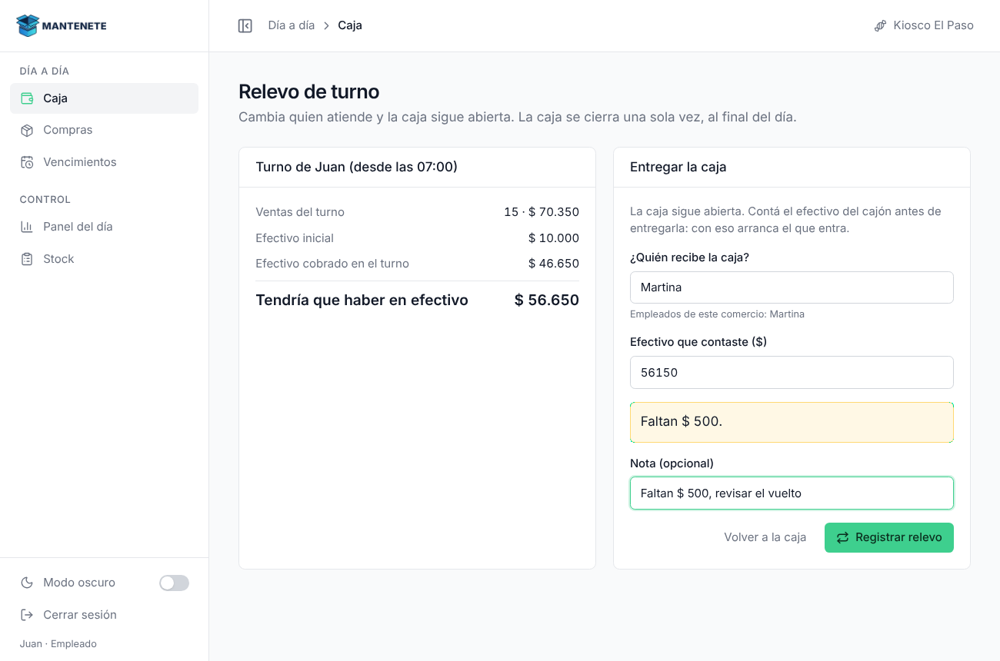
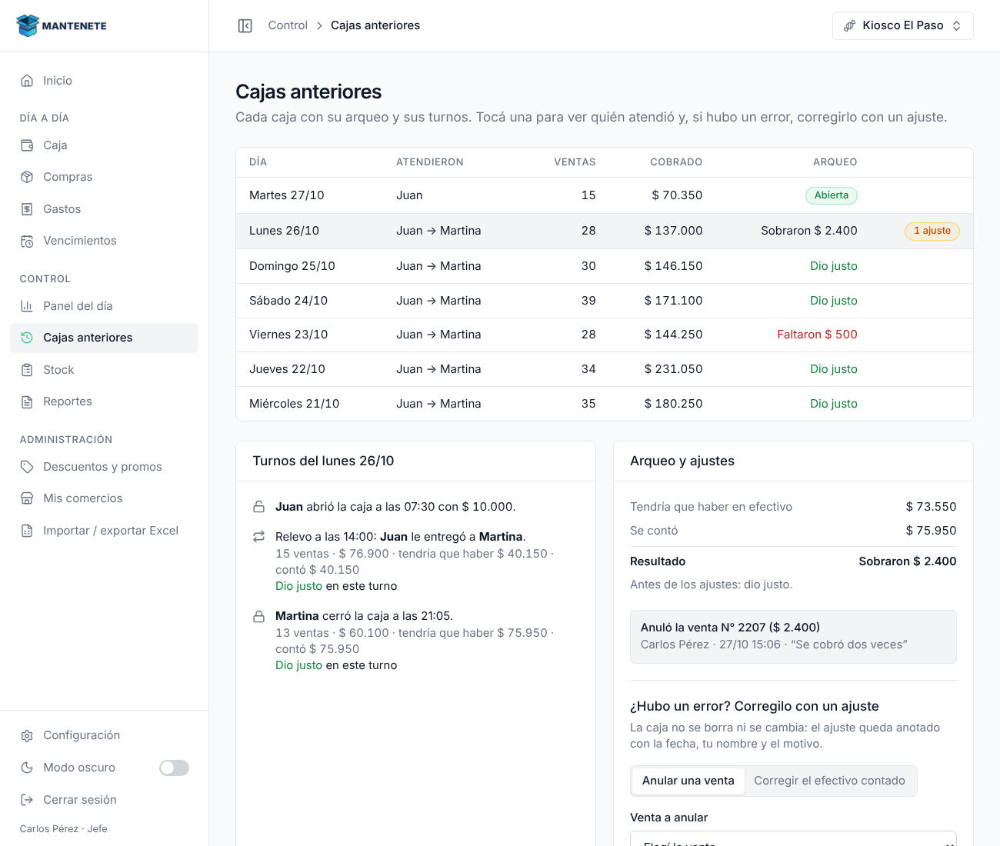

# Mantenete

Sistema de caja, stock y finanzas para comercios de barrio (kiosco, ferretería, tienda de ropa…),
pensado para un dueño con varios comercios. Hecho en **Next.js** y publicado en **Vercel**.
La lógica (ventas, stock, caja) va a quedar en una API con **FastAPI** en Railway, y los datos en **Supabase**.

> La versión anterior, hecha en Python con Streamlit, sigue guardada en la rama
> [`streamlit`](https://github.com/Nahumanas/Mini-Sistema/tree/streamlit).


Ya están **todas las pantallas** de la versión de Streamlit (también las del gimnasio), funcionando con
**datos de prueba** que se guardan en el navegador: lo que cobrás, comprás o cargás queda guardado
y se conecta entre pantallas (una venta baja el stock, una compra lo sube, etc.).
Para volver a los datos del principio: Configuración → Reiniciar datos de prueba.

| Pantalla | Qué hace |
|---|---|
| Ingresar | Jefe con PIN (demo: 1234, se cambia en Configuración) o empleado con su nombre |
| Inicio | Cómo viene el día en cada comercio y en todos juntos (solo jefe) |
| Caja | Escanear o buscar, carrito, promos automáticas, vuelto, cobrar; **ticket en PDF** (80 mm) si el comercio da ticket; abrir y cerrar caja con arqueo; **relevo de turno** (el que se va cuenta el efectivo y queda anotado si faltó o sobró en su turno); avisa cuando termina un turno o si se cobra fuera de horario |
| Compras | Cargar lo que llegó del proveedor (suma stock y actualiza el costo) |
| Gastos | Alquiler, luz, sueldos… por mes y por categoría |
| Vencimientos | Tandas con fecha de vencimiento, retirar lo vencido, pérdidas |
| Panel del día | Cobrado, ventas, ticket promedio, ventas por hora, medios de pago |
| Cajas anteriores | Cada caja con su arqueo y sus turnos. El jefe la corrige con un **ajuste** (anular una venta o recontar el efectivo) que queda anotado con fecha, quién y por qué (solo jefe) |
| Stock | Buscar, stock bajo, editar precios, stock y código de barras, crear y dar de baja productos; **cargar códigos con el lector** |
| Reportes | Por mes, semana o fechas elegidas (también los que ya pasaron), de un comercio o de todos: vendido, ganancia bruta y neta, ranking, qué comprar, **más detalles** (gastos por tipo, lo que menos vende, cuánto descontó cada promo, gimnasio) y **Excel .xlsx** con resumen, gráficos y una hoja por tema |
| Descuentos y promos | 2x1 / 3x2, % en productos o categorías, % por medio de pago |
| Mis comercios | Datos de cada sucursal, empleados, qué puede ver cada empleado y **horarios y turnos** del local |
| Importar / exportar Excel | Bajar productos, ventas y gastos; subir una lista de productos |
| Ingreso por DNI (gimnasio) | Se escribe o se escanea el DNI: verde (pasa), amarillo (al día, sin reserva: anotarlo en una clase de hoy) o rojo (debe o sin clases: se cobra ahí mismo). Anota cada entrada |
| Socios (gimnasio) | Filtros (al día, vencen pronto, deben, sin clases, dados de baja) y la **ficha** de cada socio: cobrar la cuota, sus reservas, historial y datos. **Importar socios** desde el Excel que el gimnasio ya tiene (.xlsx o .csv) con vista previa |
| Cuotas y vencimientos (gimnasio) | Cobrar una cuota (entra a la caja abierta), quién vence pronto y quién debe, con el recordatorio por WhatsApp ya escrito |
| Clases (gimnasio) | La grilla de la semana con los lugares libres, anotar socios, lista de espera, cancelar con la regla de horas, Vino/Faltó y "Agregar al calendario" (Google, iPhone o WhatsApp). El jefe arma la grilla |
| Planes y actividades (gimnasio) | Planes por meses o días, libres o por clases, para todas o algunas actividades; las reglas del gimnasio y un ejemplo para arrancar de cero |
| Configuración | Tema, **cambiar el PIN** (se guarda solo su huella), avisos de Telegram, reiniciar los datos de prueba |

## Capturas

| Caja con promo | Stock |
|---|---|
|  |  |
| **Reportes (modo oscuro)** | **Panel del día** |
|  |  |
| **Relevo de turno** | **Cajas anteriores (con un ajuste)** |
|  |  |

| **Gimnasio: Ingreso por DNI** | **Gimnasio: Clases de la semana** |
|  |  |

**Importar socios del gimnasio**


## Cómo correrlo en tu PC

1. Instalá **Node.js 20 o más nuevo** desde https://nodejs.org (la versión LTS).
2. Abrí una terminal en esta carpeta y corré, una sola vez:
   ```
   npm install
   ```
3. Para verlo:
   ```
   npm run dev
   ```
4. Abrí http://localhost:3000 en el navegador. Los cambios en el código se ven al guardar.

Entrá como jefe con el PIN `1234`, o como empleado con cualquier nombre (el empleado ve solo la Caja
y las pantallas que el jefe le habilitó en Mis comercios).

Para probar el lector de barras: en la caja escribí un código (por ejemplo `7790001000101`) y apretá Enter.
Sin código: escribí parte del nombre (`cano`, `canilla`), elegí con las flechas y Enter.

## Pruebas automáticas

En la carpeta `pruebas/` hay pruebas que revisan solas las cuentas que no pueden fallar: el arqueo de la caja
y los relevos, las promos, el stock al vender, comprar y anular, los reportes, las cuotas del gimnasio,
las fechas y el PIN. No usan internet ni base de datos: le pasan datos inventados a las cuentas y miran el resultado.

```
npm test
```

Tiene que decir `Tests  51 passed`. Si alguna dice `FAIL`, un cambio rompió algo que antes andaba.
GitHub las corre solo en cada PR y en cada cambio que llega a `main` (`.github/workflows/pruebas.yml`).
Cuando esté la base de datos, estas mismas pruebas sirven para comprobar que las cuentas no cambiaron.

## Seguridad

Lo que ya tiene la web (con los datos de prueba en el navegador):

- PIN de jefe propio (de 4 a 8 números, no muy fácil): se guarda una huella SHA-256 con sal, nunca el PIN.
  En la demo, "Me olvidé el PIN" vuelve a los datos de prueba (con Supabase va a ser por mail).
- Jefe con PIN: 3 intentos mal y hay que esperar 30 segundos. Si nadie usa la compu durante 30 minutos,
  la sesión del jefe se cierra sola y hay que volver a poner el PIN.
- Empleado: solo ve la Caja y lo que el jefe le habilitó en Mis comercios; no cambia de sucursal.
- Una caja cerrada no se cambia: el jefe la corrige con un ajuste que queda anotado (no se borra nada).
- Protecciones del navegador (en `next.config.ts`): nadie puede meter el sistema adentro de otra página,
  sin cámara, micrófono ni ubicación.

Lo que llega con Supabase y la API: ingreso con Gmail, RLS (cada dueño ve solo lo suyo), revisar los permisos
también en el servidor, PIN guardado en la base, el cifrado de los datos de cada comercio y los avisos de Telegram.

## Qué hay en cada carpeta

```
src/
├── app/                        Las direcciones (cada carpeta es una página)
│   ├── layout.tsx              Base de todo: letra, colores, modo oscuro sin parpadeo, avisos
│   ├── globals.css             Los colores del sistema (claro y oscuro) en un solo lugar
│   ├── ingresar/               /ingresar
│   └── (panel)/                Pantallas de adentro (el paréntesis no aparece en la dirección)
│       ├── layout.tsx          Usa el Marco: menú + barra de arriba + permisos
│       └── caja/, stock/, ...  Una carpeta por pantalla; cada una muestra su componente
├── components/
│   ├── layout/                 Marco, Sidebar (menú) y Topbar (migas + sucursal)
│   ├── caja/                   La Caja: barra de ingreso, carrito, cobro, abrir/cerrar caja
│   ├── gimnasio/               Piezas del gimnasio: semáforo, cobrar cuota, ficha del socio, importar
│   ├── pantallas/              Una pantalla por archivo (Inicio.tsx, Stock.tsx, Reportes.tsx...)
│   ├── ui/base.tsx             Piezas que se repiten: botones, tarjetas, tablas, chips, números
│   └── ui/Graficos.tsx         Gráficos de barras y de área (con los colores del tema)
├── store/                      Estado compartido (Zustand)
│   ├── datos.ts                La "base de datos" de prueba y todas sus acciones
│   ├── acciones-gimnasio.ts    Lo que se guarda del gimnasio (como operaciones_gimnasio.py)
│   ├── comercio.ts             Quién entró y en qué sucursal está
│   ├── carrito.ts              Un carrito por comercio
│   └── interfaz.ts             Tema, menú del celular y avisos
└── lib/
    ├── calculos.ts             Las cuentas de los reportes (como reportes.py)
    ├── caja.ts                 Turnos, relevos y arqueo con ajustes (como operaciones.py)
    ├── horarios.ts             Horario del local y turnos (para los avisos de la Caja)
    ├── reporte.ts              Períodos (mes, semana, fechas) y todos los números de Reportes
    ├── reporte-excel.ts        El Excel .xlsx con gráficos (como generar_reporte de reportes.py)
    ├── ticket.ts               El ticket en PDF de 80 mm (como ticket.py)
    ├── pin.ts                  La huella del PIN de jefe
    ├── promos.ts               La cuenta de las promos (como operaciones_descuentos.py)
    ├── gimnasio.ts             Las reglas del gimnasio: semáforo, vencimientos, grilla, DNI
    ├── calendario.ts           Google Calendar, archivo .ics y links de WhatsApp
    ├── socios-excel.ts         Leer el Excel de socios que sube el jefe
    ├── tipos.ts                Cómo es cada cosa (las tablas de esquema.sql)
    ├── datos-demo.ts           Arma los datos de prueba (como generar_datos_prueba.py)
    ├── demo-gimnasio.ts        El gimnasio de ejemplo (como demo_gimnasio.py)
    ├── api.ts                  Donde va a ir la conexión con FastAPI
    ├── navegacion.ts           El menú y quién ve qué
    └── fechas.ts, formato.ts   Fechas en hora argentina y pesos ($ 33.220)
```

## Colores

Están todos en `src/app/globals.css`, como variables: `--fondo`, `--superficie`, `--borde`,
`--texto`, `--primary-color` (el verde de Cobrar)... El modo oscuro solo cambia esas variables.
En el código se usan con nombres cortos: `bg-superficie`, `border-borde`, `bg-primary`, `text-texto-suave`.

## Publicarlo en Vercel

1. En https://vercel.com entrá con GitHub → **Add New → Project** → elegí `Mini-Sistema` → **Deploy**
   (Vercel reconoce Next.js solo; no hay que cambiar nada).
2. Cuando esté la API, en Vercel → Settings → Environment Variables agregá `NEXT_PUBLIC_API_URL`
   con la dirección de Railway (ver `.env.example`).

Cada vez que subas un cambio a GitHub, Vercel lo publica solo.

## Lo que falta

- Ingreso con Supabase (Gmail y contraseña) y permisos jefe/empleado de verdad.
- La API de FastAPI: cada acción de `store/datos.ts` pasa a llamar a `lib/api.ts`.
- Del gimnasio: reservas desde el celular del socio (link y QR) (necesita la API). Una cuota cobrada por error se anula en Cajas anteriores.
- Avisos de Telegram (necesitan la API).
